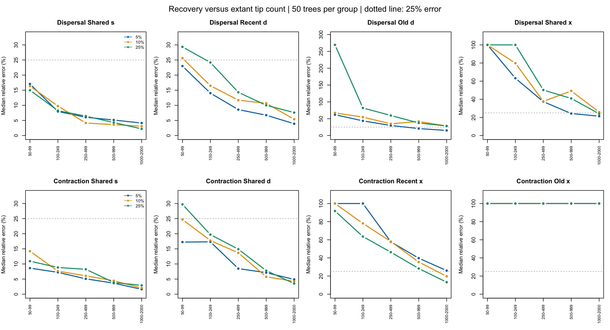
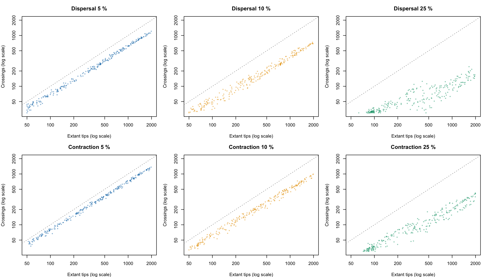

# Dispersal and revised contraction: recovery results

## Main conclusion

The computation completed cleanly, but this is not the same as reliable recovery of every parameter. Increasing tree size markedly improves most rates. **Dispersal change is substantially recoverable on large trees, with old dispersal and shared contraction less precise than speciation or recent dispersal. Revised contraction reliably recovers shared s and d on large trees, and increasingly recovers recent x, but old x = 0.005 remains poorly resolved up to 2,000 tips.**

This is a correct-model, complete-sampling benchmark conditional on selected tree sizes and at least 30 reconstructed crossings. Boundary ages are supplied as known. Conclusions do not establish performance when boundaries are estimated, sampling is incomplete, or the model is misspecified.

## Design and completeness

Two scenarios, 750 independent trees each: 50 trees in each of five size groups at 5%, 10% and 25% boundaries. Each tree has two epochs. Dispersal changes from 0.1 to 0.3, with s = 0.1 and x = 0.05 linked across epochs. Contraction changes from 0.005 to 0.05, with s = d = 0.1 linked. Four free parameters per fit, three jittered starts per tree.

All 4,500 expected fit files were present, with valid finite primary likelihoods. All 151 Slurm allocations, including the two smoke tasks, completed with exit code 0. There were no missing trees, fit errors or timeouts. All 1,500 trees enter the main recovery summaries; no unsuccessful starts were silently discarded.

| Diagnostic | Dispersal | Contraction |
|---|---:|---:|
| Trees | 750 | 750 |
| Valid primary fits | 2,250/2,250 | 2,250/2,250 |
| Optimizer convergence code 0 | 2,250/2,250 | 2,250/2,250 |
| Strict three-start likelihood agreement | 728/750 (97.1%) | 732/750 (97.6%) |
| Maximum within-tree likelihood spread | 1.9304 | 0.0543 |
| Median fit seconds | 2.94 | 4.14 |
| 95th percentile fit seconds | 15.81 | 26.16 |
| Maximum fit seconds | 324.07 | 381.06 |

Strict agreement requires all three primary fits to converge and their log-likelihood range to be below 0.0001. The highest finite primary likelihood is selected per tree. Non-agreement is concentrated in smaller trees; every 1,000–2,000-tip tree passes strict agreement. None of the strict trees has a maximum across-start parameter range greater than 25% of its generating rate. These checks do not prove a global optimum.

Separate near-zero boundary diagnostics were attempted for 1,433 starts; 797 returned code 0. Eight diagnostics improved over their own primary start by more than 0.0001 (maximum gain 0.00272), but **no converged boundary diagnostic improved over the selected best primary fit by more than 0.0001**. Boundary fits were not substituted into the primary recovery results. Diagnostic nonconvergence remains recorded in the CSV, rather than being counted as successful primary inference.

Maximum Slurm-reported MaxRSS was approximately 1.37 GiB; this is the reported step/task memory statistic, not an independently measured aggregate of all worker processes. The longest allocation took 8 min 55 s. Every fit was below the 20-minute timeout.

## Recovery at 1,000–2,000 tips

Entries are **median absolute relative errors**, in percent: 100 × |estimate / truth − 1|. Lower is better. They are not biases, confidence intervals or coverage probabilities.

| Scenario | Boundary | Shared s | Recent d / shared d | Old d / recent x | Shared x / old x |
|---|---:|---:|---:|---:|---:|
| Dispersal | 5% | 4.1 | 3.9 | 15.1 | 21.4 |
| Dispersal | 10% | 3.1 | 5.4 | 28.3 | 25.8 |
| Dispersal | 25% | 2.2 | 7.6 | 28.4 | 24.0 |
| Contraction | 5% | 1.6 | 4.9 | 26.0 | ~100 |
| Contraction | 10% | 2.0 | 4.2 | 19.7 | ~100 |
| Contraction | 25% | 2.9 | 3.5 | 13.2 | ~100 |

For dispersal, the four columns mean shared s, recent d, old d and shared x. For contraction they mean shared s, shared d, recent x and old x.

All four parameters were simultaneously within 25% of truth in 38%, 34% and 34% of large dispersal trees at 5%, 10% and 25%, respectively. With a 50% tolerance these proportions were 86%, 70% and 70%. Thus even large dispersal trees do not uniformly yield four precisely estimated rates.

For large contraction trees, all four parameters were within 25% in only 6%, 2% and 4% of replicates. Old x was within 25% in only 10%, 4% and 4%, and was below 1e-5 in 20/50, 18/50 and 16/50 trees. Some other estimates substantially overshot the small truth; the median error near 100% does not mean every estimate is zero. The weak old-rate result persists among strict-agreement fits. It is consistent with limited information about a small loss rate, but definitive separation of weak identifiability from numerical limitations would require likelihood profiles or additional accuracy tests.

For both scenarios, the estimated changing rate was greater in the recent epoch in all 150 large-tree replicates. Correct direction is not a significance test or evidence that both rates are accurately estimated.

## Dependence on tip number

The strongest general result is improved recovery with more tips. For 50–99-tip dispersal trees, median old-d error is 62%, 67% and 269% at 5%, 10% and 25%; at 1,000–2,000 tips it falls to 15%, 28% and 28%. Shared-x error falls from approximately 100% in each small-tree group to 21–26% in large trees.

For contraction, recent-x error falls from approximately 100%, 100% and 92% in small trees to 26%, 20% and 13% in large trees. Old-x median error stays approximately 100% across the size groups. Larger trees can reduce extreme overestimates without moving this median appreciably; this explains why its transformed-error regression still has a negative slope.

[Dispersal: estimates versus truth](plots/Dispersal-recovery.png) · [Contraction: estimates versus truth](plots/Contraction-recovery.png). Red dashed lines are generating rates. Boxplots show replicate distributions, with outliers retained; vertical scales vary across panels. They are not confidence intervals for individual fitted rates.

## Crossings and epoch boundary

Large-tree median crossing counts were:

| Scenario | 5% | 10% | 25% |
|---|---:|---:|---:|
| Dispersal | 827.5 | 507.5 | 135.5 |
| Contraction | 971 | 663.5 | 286.5 |

At roughly similar final sizes, older boundary placements leave fewer reconstructed crossings. Dispersal's old d is better recovered at 5% than at 10% or 25%. Conversely, contraction's recent x improves as the recent epoch occupies more of the tree. There is no universally best boundary for all parameters.

The 30-crossing rule is only a lower screening threshold, not a guarantee of good inference. In dispersal's 25%/50–99-tip group, the median is only 31 crossings and median old-d error is 269%. Those trees were rare in simulation and required extensive targeted proposals; they are a strongly selected sample, not typical trees from the generating process.

[Dispersal error versus crossings](plots/Dispersal-error-vs-crossings.png) · [Contraction error versus crossings](plots/Contraction-error-vs-crossings.png). Points are individual trees. Lines join medians in five equal-count crossing groups within each boundary. Both axes are transformed as labelled; no high-error observations are removed. Lines are descriptive, not adjusted predictions.

## Regression analysis

For each scenario and rate, fit log(1 + absolute relative error) against log2(tip count), or separately log2(crossings), adjusting for boundary-by-generating-duration cells. HC3 robust 95% intervals accompany coefficients. A negative coefficient means lower transformed error per doubling of the predictor. These are exploratory associations within the selected simulations, not causal effects. Nominal intervals are not multiple-testing adjusted.

In both separate-predictor models, all eight rate-specific slopes are negative with intervals excluding zero. The same qualitative result holds after excluding all 40 trees without strict three-start agreement. Unadjusted Spearman correlations between error and tip count range from −0.40 to −0.51 for dispersal and −0.29 to −0.55 for contraction; correlations with crossings range from −0.41 to −0.46 and −0.29 to −0.49, respectively.

Tips and crossings are strongly correlated on the log scale: r = 0.81 for dispersal and 0.90 for contraction. Joint models including both predictors give unstable/occasionally reversed conditional associations (for example, old dispersal's crossing coefficient turns positive). They are provided in the CSV for transparency, but do not justify an independent causal claim that adding crossings helps or harms recovery at a fixed tip count. Boundary, duration, tree shape and retention all influence these quantities. A crossed simulation design would be needed to better separate their contributions.

## Recommendations

1. Keep all groups in the supplementary benchmark to show where inference succeeds and fails; do not summarize optimizer code 0 as successful recovery.
2. For dispersal, emphasize the strong recovery of s and recent d on large trees, and moderate precision of old d and x. Prefer 5% if the specific target is old d under this generating setup, without treating it as universally optimal.
3. For contraction, do not claim reliable recovery of all four rates. Shared s and d are strong, recent x improves with size and recent-epoch exposure, but old x = 0.005 remains the limiting parameter.
4. If old x is central to the paper, profile a representative set of large-tree likelihoods before changing the optimizer or interpreting near-zero estimates. A less extreme generating value would test a different scientific scenario, not repair this one's recovery.

No individual-fit likelihood intervals were calculated. The lower/upper values in recovery-by-group.csv are central 95% replicate ranges, not confidence-interval coverage. The analysis uses explicit steps and loops following the readable-R skill; original simulations and fits were preserved.

## Reproducibility and outputs

Run `Rscript analyse.R`, then `Rscript diagnostics.R` in this directory after downloading results. See [README](README.md) for generation and fitting settings.

- [Convergence summary](summary/convergence.csv), [all starts](summary/starts.csv), [flagged trees](summary/flagged-fits.csv), [boundary diagnostics](summary/boundary-checks.csv).
- [Recovery by scenario, boundary and size](summary/recovery-by-group.csv), [joint accuracy](summary/joint-accuracy.csv), [regression coefficients and intervals](summary/information-regressions.csv).
- [Best primary fits](summary/best-fits.csv), [parameter agreement across starts](summary/parameter-start-agreement.csv), [Slurm accounting](accounting.txt).
