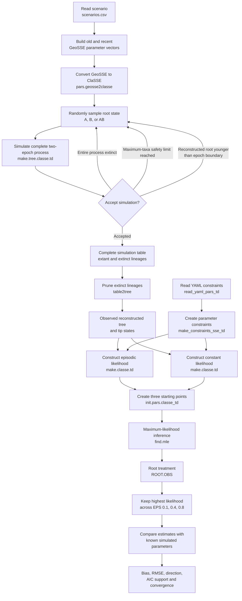

# Episodic GeoSSE parameter-recovery benchmark

## Fixed-time pilot (current diagnostic design)

The new pilot uses fixed epoch durations and five datasets for each of P01-P05,
including changes in all three rates (P05). It uses independent calibration
simulations to target information in the old epoch, then three independently
perturbed starting vectors for each six-rate episodic fit. A per-start process
limit of 90 seconds prevents a difficult fit from blocking the batch.

```sh
Rscript inst/benchmarks/archive/pilots/geosse-parameter-recovery/R/06-fixed-time-pilot.R
Rscript inst/benchmarks/archive/pilots/geosse-parameter-recovery/R/07-report-fixed-time-pilot.R
```

Results, actual initial vectors, convergence diagnostics, PNG/PDF plots and a
Markdown report are in `results/fixed-time-pilot/`. The 06 script regenerates
that pilot directory's results when rerun; it does not resume existing fits.
Earlier scripts and results below describe the previous nine-scenario pilot.
The fixed-time pilot fits the episodic model only. Production epoch-position
and tree-size experiments still require a finalized design.

For the P05 nuisance profiles and numerical audit, run `R/08-profile-p05.R`
then `R/09-report-p05-profiles.R` from this benchmark's script paths. Results
and the report are in `results/fixed-time-pilot/profiles/`. These scripts fix
each old-epoch focal rate in turn, optimize the other five rates from two
starts, and compare integration tolerances and GSL steppers. Incomplete grid
points and nuisance bounds are reported explicitly.

The follow-up rate-variant pilot is run with `R/10-rate-variants-pilot.R` and
reported with `R/11-report-rate-variants.R` (use the complete benchmark paths
when invoking Rscript from the repository root). It includes a fresh P05
baseline, slower recent speciation, higher old dispersal, higher old
contraction, and a constant-rate control. Each tree is fitted with episodic
and constant ClaSSE; control trees are also fitted with classical
`diversitree::make.geosse()` under the same three shared-rate constraints.
Results are in `results/rate-variants-pilot/`. The runner reuses saved fits;
use a new output directory when changing the design or optimizer settings.

This benchmark tests whether `divextra::make.classe.td()` recovers known
GeoSSE parameters when rates differ between two time epochs. It is intended
for the supplementary material of the Sunken Islands paper.

The benchmark focuses on the episodic extension. The underlying likelihood is
the ClaSSE likelihood implemented in `diversitree`.

## Questions

The analysis asks whether recovery depends on:

1. which GeoSSE rates differ between epochs;
2. the position of the epoch boundary;
3. the approximate number of extant tips.

The benchmark uses the three GeoSSE states `A`, `B`, and `AB`. Within an epoch,
the model is symmetric between areas:

- `sA = sB = sAB = s`;
- `dA = dB = d`;
- `xA = xB = x`.

The fitted episodic model therefore has six rate parameters:
`s_recent`, `d_recent`, `x_recent`, `s_old`, `d_old`, and `x_old`. The epoch
boundary is fixed to its simulated value.

## Simulation and inference workflow



Every accepted replicate therefore contains a newly simulated tree. The
analysis does not fit repeatedly to one fixed tree.

## Epoch orientation

The simulator and likelihood number epochs in opposite directions.

- In `make.tree.classe.td()`, row 1 is the old, rootward epoch and row 2 is the
  recent, tipward epoch.
- In `make.classe.td()`, parameter suffix `.1` is the recent epoch and suffix
  `.2` is the old epoch.

The scripts preserve this conversion explicitly. Simulation truth from row 1
is compared with fitted parameters ending in `.2`, and simulation truth from
row 2 is compared with parameters ending in `.1`.

## Scenarios

`config/scenarios.csv` contains nine unique conditions.

### Parameter scenarios

Five parameter scenarios use a nominal 50% epoch boundary and exactly 200
extant tips in every accepted simulation:

1. constant rates;
2. speciation shift;
3. dispersal shift;
4. contraction shift;
5. all three rates differ between epochs.

### Epoch-boundary scenarios

The speciation-shift scenario is also simulated with nominal boundaries at
25% and 75% of the total simulated duration. The 50% condition is already the
baseline parameter scenario.

Because `make.tree.classe.td()` begins with a stem lineage and `table2tree()`
returns the reconstructed crown tree, the realized boundary fraction can
differ slightly from the nominal fraction. Both the absolute boundary age and
the realized fraction of reconstructed tree height are saved.

### Tree-size scenarios

The speciation-shift scenario with a 50% boundary is simulated with exactly
50, 200, and 500 extant tips. The requested size is passed directly to
`make.tree.classe.td()` as `max.taxa`. Epoch 2 uses `max.t2 = Inf` so that an
accepted simulation stops through the taxon limit rather than a time limit.

The wrapper rejects a simulation unless all of the following are true:

- epoch 1 reached its requested duration;
- `table2tree()` returned exactly the requested number of extant tips;
- total simulated time is finite and later than the epoch transition;
- the transition lies within the reconstructed crown tree;
- the reconstructed root state is valid.

These checks avoid changing `make.tree.classe.td()`. The old calibration step
currently supplies a reference duration used to place the epoch transition.
It no longer determines the accepted number of tips. The realized epoch
fraction is saved and must be inspected because final tree age is stochastic.

## Replication and starting points

The local pilot uses five independently simulated datasets per scenario. The
production analysis uses 100 datasets per scenario, or 900 datasets in total.

Each model is fitted from three starting points, following the strategy used
in the Sunken Islands analyses:

```r
EPS <- c(0.1, 0.4, 0.8)
```

All fits are retained. The fit with the highest log likelihood is used for
parameter-recovery summaries. Agreement among starting points is reported as
an optimization diagnostic.

By default, each dataset receives both:

- the six-rate episodic model;
- a three-rate constant model constrained across epochs.

The constant comparison is represented as two epochs with all rates shared.
This gives the same likelihood as ordinary time-homogeneous ClaSSE while
keeping the same epoch boundary and likelihood machinery. The current
`make.classe.td(..., n.epoch = 1)` path is not used because it fails inside the
time-dependent branch evaluator; this is a separate compatibility issue to
repair in DivExtra.

## Root and survival conditioning

At the start of every simulation attempt, the root state is sampled uniformly
from `A`, `B`, and `AB`. If that process goes entirely extinct, a new attempt
draws a new root state and a new tree.

Inference does not receive the simulated root state. It uses the
Maddison-FitzJohn treatment implemented in `diversitree` as `ROOT.OBS`. Under
this treatment, the root weights are proportional to the conditional
likelihood of the observed data in each root state. Fits use
`condition.surv = TRUE`, matching the retention of surviving simulated trees.

Trees whose reconstructed root is younger than the epoch boundary contain no
information from the old epoch and are resimulated. Entirely extinct
simulations are also resimulated. No filtering on the final number of tips is
used in the main benchmark.

## Directory contents

```text
geosse-parameter-recovery/
├── README.md
├── config/
│   ├── model-constant.yml
│   ├── model-episodic.yml
│   └── scenarios.csv
├── R/
│   ├── benchmark-functions.R
│   ├── 00-calibrate-tree-sizes.R
│   ├── 01-run-one.R
│   ├── 02-run-local.R
│   └── 03-summarize.R
├── roihu/
│   ├── run-array.sh
│   └── submit.sh
└── results/
    ├── calibrated/
    ├── raw/
    ├── summaries/
    └── logs/
```

The scripts create the `results` subdirectories when needed. Full raw results
should not be committed to the package or submitted to CRAN. Keep them in the
Sunken Islands analysis repository or archive them separately. Only scripts,
configuration files, and compact final summary tables belong in the package.

## Software setup

Run the scripts from the root of the DivExtra repository. Install the current
checkout before starting:

```sh
R CMD INSTALL .
```

The required R packages are `divextra`, `diversitree`, and `ape`.

## Step 1: calibrate tree sizes

Calibration estimates a fixed simulation duration for each scenario so that
the median number of extant tips is close to its target. It uses a small
stochastic bisection search and does not create datasets used in parameter
recovery.

```sh
Rscript inst/benchmarks/archive/pilots/geosse-parameter-recovery/R/00-calibrate-tree-sizes.R
```

The resulting file is:

```text
inst/benchmarks/archive/pilots/geosse-parameter-recovery/results/calibrated/scenarios-calibrated.csv
```

Inspect the calibrated durations and median tip counts before continuing.

## Check the simulator before fitting

This fast pilot simulates exact-tip trees without fitting either likelihood
model. The optional argument gives the number of replicates per scenario.

```sh
Rscript inst/benchmarks/archive/pilots/geosse-parameter-recovery/R/04-check-simulator.R 3
```

It checks the accepted tip counts and epoch placement and reports rejected
attempts, extinct terminal lineages, realized boundary fractions, and runtime.
Outputs are written to `results/simulator-check/`.

## Step 2: smoke test one replicate per scenario

```sh
Rscript inst/benchmarks/archive/pilots/geosse-parameter-recovery/R/02-run-local.R 1
```

This creates nine simulated datasets and fits each from three starting points.

## Step 3: local pilot with five replicates

```sh
Rscript inst/benchmarks/archive/pilots/geosse-parameter-recovery/R/02-run-local.R 5
```

Existing successful result files are skipped, so the command can be resumed.
To rerun a dataset, remove its individual RDS file first.

## Step 4: summarize the pilot

```sh
Rscript inst/benchmarks/archive/pilots/geosse-parameter-recovery/R/03-summarize.R
```

The script writes dataset-level estimates, start-level optimization results,
and scenario-level recovery summaries to `results/summaries/`.

## Step 5: plot parameter recovery

```sh
Rscript inst/benchmarks/archive/pilots/geosse-parameter-recovery/R/05-plot-parameter-recovery.R
```

This writes PDF and PNG versions of the estimated-versus-true plot and the
scenario-level recovery-interval plot to `results/plots/`.

Before the Roihu run, inspect:

- the distribution of actual tip counts;
- simulation and optimization failure rates;
- agreement among the three starting points;
- estimates at numerical boundaries;
- runtime as a function of tree size;
- whether the old and recent epochs both contain enough tree history.

## Step 6: send the production analysis to Roihu

Copy or clone the DivExtra repository on Roihu, install the same package
checkout, and run calibration once if the calibrated CSV was not copied.

The production design contains 900 array tasks:

```text
9 scenarios x 100 replicates = 900 datasets
```

Review the Slurm account, partition, memory, and time settings in
`roihu/run-array.sh`, then submit:

```sh
bash inst/benchmarks/archive/pilots/geosse-parameter-recovery/roihu/submit.sh
```

One array task simulates and fits one dataset. Each task writes one RDS file,
so interrupted arrays can be submitted again safely. The array script limits
simultaneous jobs with `%25`; adjust this only after checking Roihu policy and
the pilot runtime.

## Outputs

Each raw RDS file stores:

- scenario and replicate identifiers;
- random seed;
- simulated stem-root state and reconstructed crown-root state;
- true GeoSSE rates;
- simulated tree and simulation metadata;
- actual number of extant tips;
- tree height and epoch boundary;
- all fits from all starting points;
- best episodic and constant fits;
- parameter estimates, likelihood, AIC, convergence code, and runtime;
- R and package versions.

The summary script reports parameter bias, relative bias, RMSE, empirical 95%
quantiles, recovery of the direction of epoch change, AIC support for the
episodic model, and optimization agreement across starting points.

## Interpretation

### Revised linked-rate design (next benchmark)

`config/scenarios-linked.csv` records the agreed replacement design: six free
parameters when all rates change, four when only one rate changes, and three
when all rates are shared. Recent contraction is **0.05** in the all-rates-change
and contraction-only scenarios; it remains **0.02** in the other scenarios.
The `link_s`, `link_d`, and `link_x` columns specify equality constraints across
epochs that must be imposed during inference, not just during simulation.
Geographic symmetry is retained within each epoch.

Run `R/12-linked-rate-pilot.R` and then `R/13-report-linked-rate-pilot.R`
from the repository root. The runner reads these links and fits the correctly
constrained model, with an additional classical GeoSSE fit for constant controls.
It uses five trees per scenario, three starts, 30 old plus 6 recent time units,
and saves to `results/linked-rate-pilot/`. This pilot does not yet vary epoch
position or target tip number. The report records realized tip counts, crossing
lineages, reconstructed branch exposure and branching events, and separately
full-history event counts. Previous pilot scripts and results are unchanged.
Use a fresh output directory if changing settings; existing fits are reused.

`R/14-screen-tree-information.R` runs a simulation-only screening: 50 attempts
for each of the five linked-rate scenarios at boundary ages 9, 18 and 27 within
a fixed 36-unit stem simulation duration. These fractions are not fractions of
the variable reconstructed crown age. It applies the proposed minima of 50 tips,
10 crossing lineages and 10 reconstructed branching events per epoch, saving
every attempt and conditional size distributions in `results/information-screen/`.
The old-node rule actually requires 11 crossing lineages on a binary tree.
Runs cut short by the 4000-taxon safety cap are reported separately; accepted
tree distributions therefore do not describe the uncapped upper tail.

### Calibrated 5/25/50-percent pilot, maximum 1000 tips

Run `R/15-epoch-grid-pilot.R`, then `R/16-report-epoch-grid-pilot.R`.
The new output directory is `results/epoch-grid-pilot/`. All five rate scenarios
are crossed with all three boundaries, with five fresh accepted trees per cell.
Rates and model links remain unchanged. Only total simulation duration is
calibrated separately per cell, using 30 independent attempts at each duration
18, 24, 30, 36, 42 and 48. Highest acceptance wins; ties favor median size nearest
200 tips. If no candidate accepts a tree, the shortest duration is the explicit
fallback and final generation still must obtain all five qualifying trees.
Selection requires 50--1000 tips, at least 10 crossing lineages and 10 branching
events per epoch. The simulator is unchanged; early cap stops are rejected.
Calibration and recovery use independent seeds. All rejection attempts are saved.

Three optimization starts fit each correctly linked model; the constant controls
also receive classical GeoSSE fits. The report checks full-vector likelihood
equivalence, summarizes convergence and recovery, and fits exploratory
cell-adjusted error regressions separately for each independent parameter and
information predictor. HC3 intervals describe regression slopes, not parameter
recovery coverage. Both absolute log10 error and bounded symmetric error are
reported; selected-sample associations are not causal effects.

The empirical 95% interval across recovered estimates describes the sampling
distribution of the estimator. It is not a confidence interval calculated for
an individual dataset.

The constant scenario measures false detection of an epoch effect. The
nonconstant scenarios measure recovery of effect direction and magnitude.
Poor recovery in small trees or near extreme epoch boundaries should be
reported as a limitation rather than removed from the analysis.

